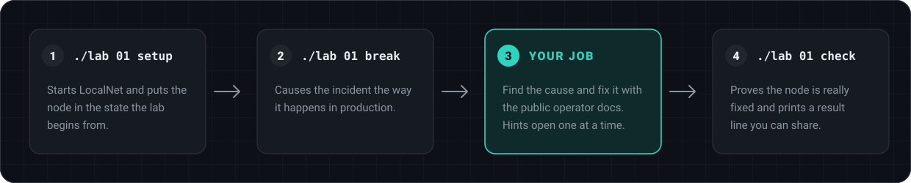
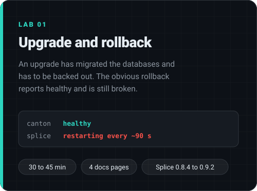
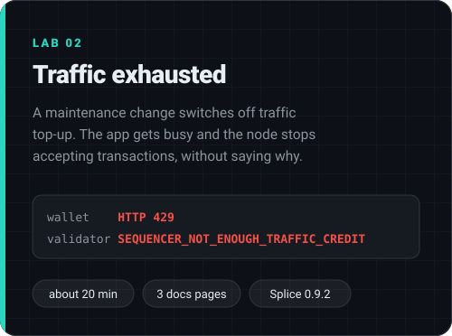

<p align="center">
  
</p>

<p align="center">
  <a href="#quick-start"></a>
  <a href="labs/01-upgrade-rollback"></a>
  <a href="labs/02-traffic-exhausted"></a>
  <a href="https://docs.canton.network"></a>
</p>

<p align="center">
  <a href="https://github.com/UnityNodes/canton-operator-labs/actions/workflows/labs.yml"></a>
  <a href="LICENSE"></a>
  <a href="LICENSE-docs"></a>
  
  
</p>

Practise real Canton validator incidents on your own machine. Each lab breaks a local Canton Network the way nodes break in production. You find the cause and fix it with the public operator docs. A check tells you when the node is really fixed.

Everything runs on LocalNet, the Docker Compose network that ships with [Splice](https://github.com/canton-network/splice). Nothing touches DevNet, TestNet or MainNet, and you do not need a validator of your own.

> [!TIP]
> Many operators meet a failed upgrade or an empty traffic balance for the first time in production. The docs describe the fix, but reading a fix is not the same as having done it. These labs give you the incident first, then the docs, then proof that you fixed it.

## How a lab runs

<p align="center">
  
</p>

## The labs

<p align="center">
  <a href="labs/01-upgrade-rollback"></a>
  <a href="labs/02-traffic-exhausted"></a>
</p>

| Lab | Docs you work from |
| --- | --- |
| [01 Upgrade and rollback](labs/01-upgrade-rollback) | [Validator backups](https://docs.canton.network/global-synchronizer/production-operations/validator-backups), [Upgrade to a new release](https://docs.canton.network/global-synchronizer/production-operations/upgrade-canton-nodes), [Disaster recovery](https://docs.canton.network/global-synchronizer/production-operations/validator-disaster-recovery), [Validator upgrades](https://docs.canton.network/global-synchronizer/production-operations/validator-upgrades) |
| [02 Traffic exhausted](labs/02-traffic-exhausted) | [Synchronizer traffic](https://docs.canton.network/global-synchronizer/deployment/synchronizer-traffic), [Validator with Docker Compose](https://docs.canton.network/global-synchronizer/deployment/validator-docker-compose), [Transaction failures](https://docs.canton.network/global-synchronizer/troubleshooting-guide/transaction-failures) |

<p align="center">
  <a href="https://github.com/UnityNodes/canton-operator-labs/issues/new?template=lab-request.yml"></a>
</p>

## Quick start

```bash
git clone https://github.com/UnityNodes/canton-operator-labs
cd canton-operator-labs
./lab list
./lab 01 setup     # start LocalNet in the state the lab begins from
./lab 01 break     # cause the incident
                   # ... you diagnose and fix it ...
./lab 01 check     # PASS lines for what is fixed, FAIL lines for what is not
./lab down         # stop LocalNet and delete its data
```

Each lab's README tells the story, links the docs pages, and has hints you can open one at a time. If `splice` shows `starting` for more than ten minutes, run `docker restart splice`. That is a known LocalNet quirk, described [below](#known-localnet-behaviour).

**You need**

- Docker with Compose 2.24 or newer, 16 GB of memory for Docker (12 GB is the minimum), about 12 GB of disk
- bash, git, openssl, awk, sed
- Linux or macOS. Windows works through WSL 2.

The first start pulls about 2 GB of images per Splice version from `ghcr.io/digital-asset/decentralized-canton-sync`. The times in the lab table do not include that pull.

## Where to run it

Use a laptop or a spare VM. The labs start LocalNet with fixed container names (`canton`, `splice`, `postgres`, `nginx`) and refuse to start if a container with one of those names already exists, for example on a machine that also runs a validator. They also refuse to run against a remote Docker (a `DOCKER_HOST` or Docker context that points at `tcp://` or `ssh://`).

LocalNet's database and node ports are not published on your network. Only the browser UIs listen, and only on `127.0.0.1`. `./lab down` removes only the containers and volumes of the Compose project `canton-labs`.

## Prove it

`check` prints one line per condition. When everything passes it ends with a single result line you can paste anywhere to show you did the lab:

```text
lab=02-traffic-exhausted result=pass version=0.9.2 purchased=<number> at=<UTC time>
```

<p>
  <a href="https://github.com/UnityNodes/canton-operator-labs/issues/new?template=lab-result.yml"></a>
  <a href="https://github.com/UnityNodes/canton-operator-labs/issues/new?template=lab-problem.yml"></a>
</p>

If you ran a lab, a minute of feedback tells us which steps were unclear. The result line is plain text, so what helps most is an honest report: your organisation if you are happy to share it, and what was unclear.

The scripts are open source. Reading `labs/*/break.sh` or `tests/` spoils the lab, not the check: `check` still needs a node that really works. If you work with an AI assistant, [AGENTS.md](AGENTS.md) tells it to coach you instead of handing over the answer.

## Known LocalNet behaviour

After a start or restart, the `splice` container sometimes stays `starting` for good. The super validator's validator app misses its one-minute first database check while five applications boot in one JVM container, and never opens its port. Restarting the container (`docker restart splice`) brings it up. The labs do not depend on that one app: they wait for app-user's validator, Scan and the SV app, and restart `splice` up to three times if those are not ready. If you restart `splice` while fixing a lab and app-user's wallet does not answer within ten minutes, restart it once more.

<details>
<summary><strong>Settings</strong></summary>

A lab that changes node settings keeps them in `node.env`, the way a docker-compose validator keeps them in `.env`. `./lab compose up -d --no-deps splice` applies a change.

| Variable | Default | Meaning |
| --- | --- | --- |
| `LABS_NO_HOST_PORTS` | `0` | `1` also stops the browser UIs from listening on `127.0.0.1`, for machines where ports 2000 to 4000 are taken |
| `LABS_CPU_LIMITS` | `1` | `0` removes the CPU caps in `lib/compose/cpu-limits.yaml` (about 4 cores in total) |
| `LABS_READY_TIMEOUT` | `480` | Seconds to wait for the node to become ready, three times, before giving up. Raise it on a slow machine |
| `LAB_YES` | `0` | `1` answers yes when a lab asks before it removes an earlier LocalNet or breaks without backups |
| `LABS_SKIP_PREFLIGHT` | `0` | `1` skips the checks of Docker, memory and container names that run before `setup` |
| `LABS_ALLOW_REMOTE_DOCKER` | `0` | `1` allows a remote Docker daemon. The labs then delete volumes there |
| `LOCALNET_DIR_OVERRIDE`, `SPLICE_REPO` | | Use a LocalNet directory or a Splice repository of your own. The labs then run compose files from there with your Docker rights, so use only sources you trust |
| `LAB01_FROM`, `LAB01_TO` | `0.8.4`, `0.9.2` | The versions lab 01 upgrades between |
| `LAB02_VERSION` | `0.9.2` | The version lab 02 runs |

</details>

<details>
<summary><strong>How it works</strong></summary>

`lib/localnet.sh` fetches `cluster/compose/localnet` from the Splice repository at the version a lab needs, and runs it with the release's own compose files, environment files and memory limits. The labs add only two optional override files in `lib/compose/`. Scripts talk to the nodes through `docker exec`, so they work whether or not ports are published.

LocalNet configuration is fetched from the Splice repository at a pinned commit for each tested version, and the labs refuse a tag that resolves to anything else. Every lab is tested end to end in CI on a stock GitHub runner: `setup`, `break`, a scripted fix, and `check`. The workflow also runs every Monday, so a Splice release that changes behaviour shows up as a red build.

</details>

## Contributing

Bug reports and new lab ideas are welcome. See [CONTRIBUTING.md](CONTRIBUTING.md).

## Not an official project

This is an independent community project. It is not a product of the Canton Foundation or Digital Asset. It runs the unmodified Splice LocalNet and links to the public documentation at [docs.canton.network](https://docs.canton.network).

## License

Code: Apache-2.0 ([LICENSE](LICENSE)). Lab text: CC BY 4.0 ([LICENSE-docs](LICENSE-docs)).

Maintained by [Unity Nodes](https://github.com/UnityNodes).
